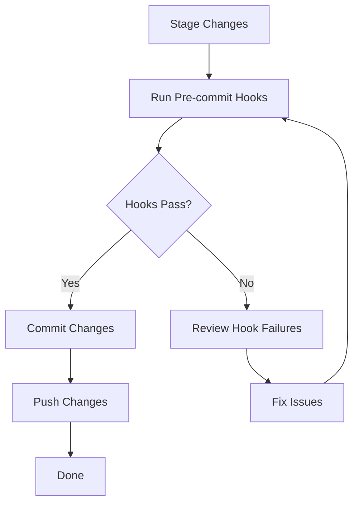

# Commit and Push Changes Process for LifeCourseID

## Overview
This document outlines the process for committing and pushing changes to the LifeCourseID repository while properly handling any issues that may arise from pre-commit hooks.

## Pre-Commit Hook Configuration
The repository has the following pre-commit hooks configured:

1. **trailing-whitespace** - Removes trailing whitespace
2. **end-of-file-fixer** - Ensures files end with a newline
3. **check-yaml** - Validates YAML syntax
4. **check-added-large-files** - Prevents adding large files
5. **ruff** - Lints Python code with automatic fixing
6. **ruff-format** - Formats Python code

## Process Flow



## Common Pre-commit Hook Issues and Solutions

### 1. Trailing Whitespace Issues
**Solution**: Remove trailing whitespace from affected lines

### 2. End-of-File Fixer Issues
**Solution**: Ensure all text files end with a single newline character

### 3. YAML Check Issues
**Solution**: Fix syntax errors in YAML files

### 4. Ruff Linting Issues
**Solution**: Fix code style issues according to PEP 8

### 5. Ruff Formatting Issues
**Solution**: Run `ruff format .` to automatically format code

## Step-by-Step Process

### 1. Stage Changes
```bash
git add .
```

### 2. Run Pre-commit Hooks Manually
```bash
pre-commit run --all-files
```

### 3. Address Any Issues
Based on the output, fix any issues that arise:
- For formatting issues: `ruff format .`
- For linting issues: `ruff check --fix .`
- For YAML issues: correct syntax errors
- For whitespace issues: remove trailing whitespace
- For EOF issues: ensure files end with newline

### 4. Commit Changes
```bash
git commit -m "Add comprehensive testing framework and CLI for LifeCourseID"
```

### 5. Push Changes
```bash
git push origin main
```

## Troubleshooting

### If Pre-commit Hooks Fail
1. Read error messages carefully
2. Identify affected files and lines
3. Apply appropriate fixes
4. Re-run pre-commit hooks to verify

## Best Practices

1. Run pre-commit hooks before committing
2. Write descriptive commit messages
3. Keep commits focused on single logical changes
4. Test changes before committing
5. Fix issues properly rather than disabling hooks

## Repository Specific Considerations

1. **Configuration files**: Pay attention to `config/scenarios.yaml`
2. **Python code**: Ensure files in `src/` and `tests/` follow formatting
3. **Large files**: Avoid adding large data files
4. **Notebook files**: `archive/old_notebooks/` is excluded from ruff formatting

## Post-Commit Verification

1. Verify commit appears on remote repository
2. Check that CI pipelines pass
3. Confirm changes work as expected
