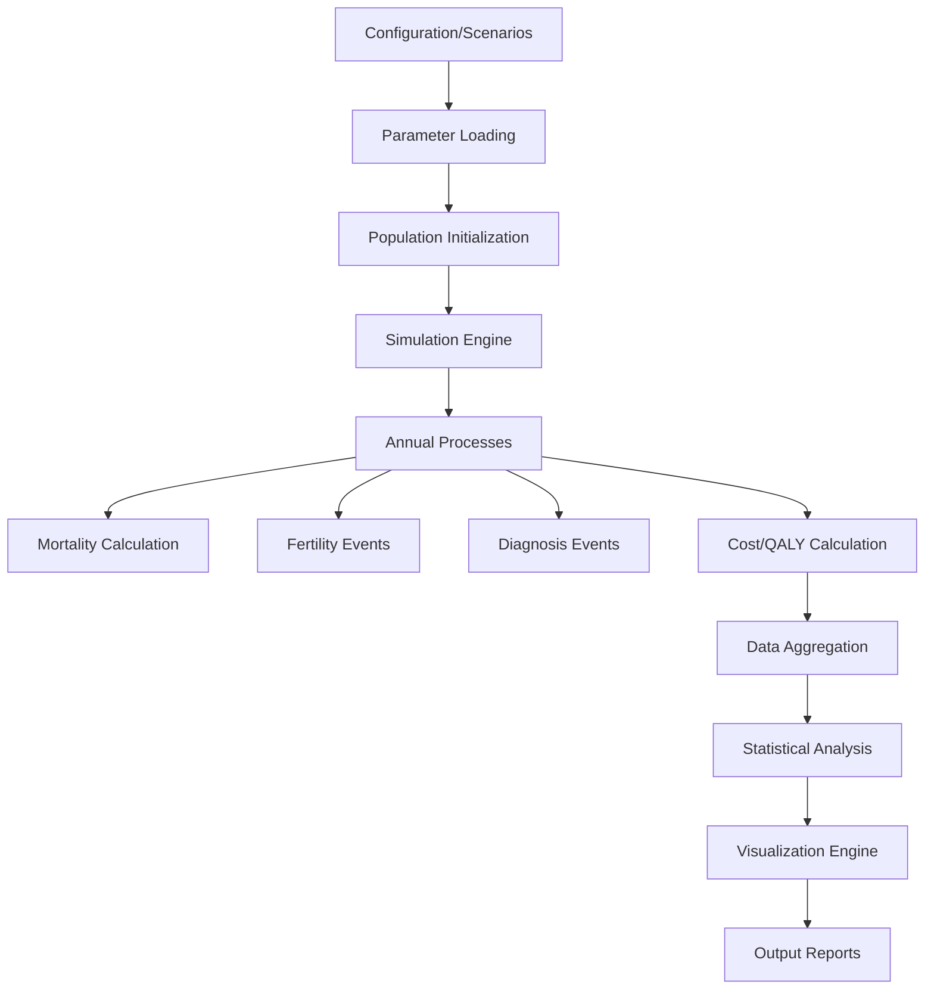

# LifeCourseID Microsimulation Model - Repository Map

## Overview

LifeCourseID is a comprehensive microsimulation model designed to evaluate the cost-effectiveness and budget impact of interventions related to a specific health condition. It simulates individual life courses over a defined time horizon, incorporating demographic events, disease progression, associated costs, and quality-adjusted life years (QALYs). The model is built with a modular Python package structure and leverages Dask for efficient parallel processing of simulations, particularly for probabilistic sensitivity analysis.

## Repository Structure

```
lifecourse/
├── .github/
│   └── workflows/
│       └── ci.yml
├── .gitignore
├── CHANGELOG.md
├── EXPLAINER.md
├── FUTURE_ROADMAP.md
├── GEMINI.md
├── LICENSE
├── Notebooks/
├── README.md
├── ROADMAP.md
├── SESSION_SUMMARY.md
├── TODO.md
├── archive/
├── config/
│   └── scenarios.yaml
├── docs/
├── drafts/
├── pyproject.toml
├── pytest.ini
├── requirements.txt
├── run_tests.py
├── src/
│   └── lifecourseid/
│       ├── __init__.py
│       ├── cli.py
│       ├── data_loader.py
│       ├── main.py
│       ├── analysis/
│       │   ├── __init__.py
│       │   ├── advanced_analysis.py
│       │   ├── plotting.py
│       │   └── run_helpers.py
│       └── model/
│           ├── __init__.py
│           ├── cohort.py
│           ├── parameters.py
│           └── population_system.py
└── tests/
```

## Architecture

The LifeCourseID model follows a modular architecture with clear separation of concerns:

1. **Model Core** (`src/lifecourseid/model/`): Contains the fundamental simulation logic
2. **Analysis Engine** (`src/lifecourseid/analysis/`): Handles data processing, statistical analysis, and visualization
3. **Data Layer** (`src/lifecourseid/data_loader.py`): Manages external data loading and scenario configuration
4. **Execution Layer** (`src/lifecourseid/main.py`): Orchestrates the complete simulation workflow
5. **CLI Interface** (`src/lifecourseid/cli.py`): Provides command-line access to specific scenarios

### Key Components

#### 1. Model Components

**Parameters** (`src/lifecourseid/model/parameters.py`):
- Defines global constants and fixed parameters
- Specifies statistical distributions for uncertain parameters (Beta, Gamma, Lognormal, Normal, Uniform)
- Provides helper functions for parameter sampling and mean value calculation
- Contains cost parameters adjusted for inflation and discounting

**Cohort Generation** (`src/lifecourseid/model/cohort.py`):
- Generates synthetic population cohorts based on demographic distributions
- Handles initial population characteristics including age, sex, severity, familial status
- Manages education levels and socioeconomic status distribution

**Population System** (`src/lifecourseid/model/population_system.py`):
- Implements core microsimulation logic through the `PopulationSystemDask` class
- Manages annual life processes: mortality, fertility, diagnosis
- Calculates costs and QALYs for individuals
- Handles both retrospective and prospective arms

#### 2. Analysis Components

**Run Helpers** (`src/lifecourseid/analysis/run_helpers.py`):
- Provides high-level functions (`run_sim` and `run_scenario`) to orchestrate simulation execution
- Manages data collection for detailed outputs
- Handles both single runs and comparative scenario analyses

**Plotting** (`src/lifecourseid/analysis/plotting.py`):
- Generates comprehensive visualizations for economic evaluation
- Includes plots for cost-effectiveness plane, CEAC, EVPI, ENMB
- Provides tornado sensitivity analysis and subgroup analysis visualizations
- Creates cost-mix stacked area plots and budget impact charts

#### 3. Data Management

**Data Loader** (`src/lifecourseid/data_loader.py`):
- Loads scenarios from YAML configuration files
- Applies scenario overrides to base parameters
- Handles both relative adjustments and absolute parameter values
- Supports scenario grid generation for parameter combinations

**Configuration** (`config/scenarios.yaml`):
- Defines deterministic scenarios with parameter overrides
- Supports both relative adjustments (±0.5) and absolute values
- Includes scenario grid functionality for parameter combinations

#### 4. Execution Components

**Main Application** (`src/lifecourseid/main.py`):
- Primary entry point for the complete simulation workflow
- Orchestrates all 21 analysis modules:
  1. Deterministic scenarios
  2. Probabilistic sensitivity analysis (PSA)
  3. Cost-effectiveness plane
  4. Cost-effectiveness acceptability curve (CEAC)
  5. Expected value of perfect information (EVPI)
  6. Expected net monetary benefit (ENMB)
  7. One-way sensitivity (tornado) analysis
  8. Sub-group analyses
  9. Cost-mix stacked area plots
  10. Budget impact analysis
  11. Equity analysis by SES quintile
  12. PSA histograms
  13. Cost-effectiveness acceptability frontier (CEAF)
  14. Input parameter summary
  15. Publication comparison
  16. Familial ID prevalence sensitivity analysis
  17. EVPPI analysis
  18. PSA ICER distribution
  19. Retrospective cost-mix analysis
  20. Calibration analysis (planned)
  21. Structural uncertainty analysis (planned)

**CLI Interface** (`src/lifecourseid/cli.py`):
- Lightweight command-line interface for running specific scenarios
- Provides quick access to incremental cost, QALY, and ICER calculations

## Data Flow



## Key Features

1. **Microsimulation Core**: Simulates individual life trajectories with age progression, mortality, fertility, and diagnosis
2. **Economic Evaluation**: Calculates comprehensive costs (health, education, social care, employment) and QALYs
3. **Parameter Uncertainty**: Incorporates probabilistic sampling from various statistical distributions
4. **Scenario Analysis**: Supports deterministic and subgroup scenarios defined in external YAML files
5. **Probabilistic Sensitivity Analysis (PSA)**: Performs Monte Carlo simulations with Dask parallelization
6. **Comprehensive Visualizations**: Generates 15+ plot types for economic evaluation
7. **Budget Impact Analysis**: Estimates 5-year incremental budget impact
8. **Equity Analysis**: Assesses outcomes by socioeconomic quintile
9. **Publication Comparison**: Facilitates comparison with external published data

## Dependencies

- **Dask**: For parallel processing of simulations
- **Pandas**: Data manipulation and analysis
- **NumPy**: Numerical computing
- **SciPy**: Statistical distributions
- **Matplotlib**: Data visualization
- **PyYAML**: Configuration file parsing
- **PyArrow**: Data serialization (optional)

## Testing

The project includes a comprehensive test suite in the `tests/` directory covering:
- Parameter sampling and distribution functions
- Cohort generation and population system logic
- Analysis helper functions
- Plotting functions
- Data loading and scenario application

Tests can be executed using `pytest` with coverage reporting.

## Usage

The model can be executed in multiple ways:
1. Full simulation workflow: `python -m lifecourseid.main`
2. Specific scenarios: `python -m lifecourseid.cli base --pop-size 100`
3. Custom configurations: `python -m lifecourseid.main --config_file path/to/config.yaml`

Output files (CSV summaries and PNG plots) are saved in the `results/` directory.
