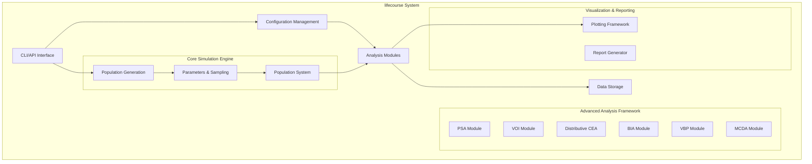
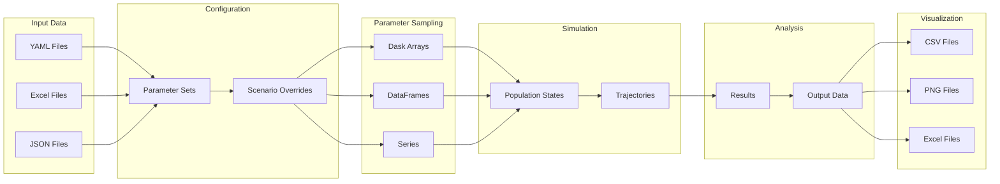
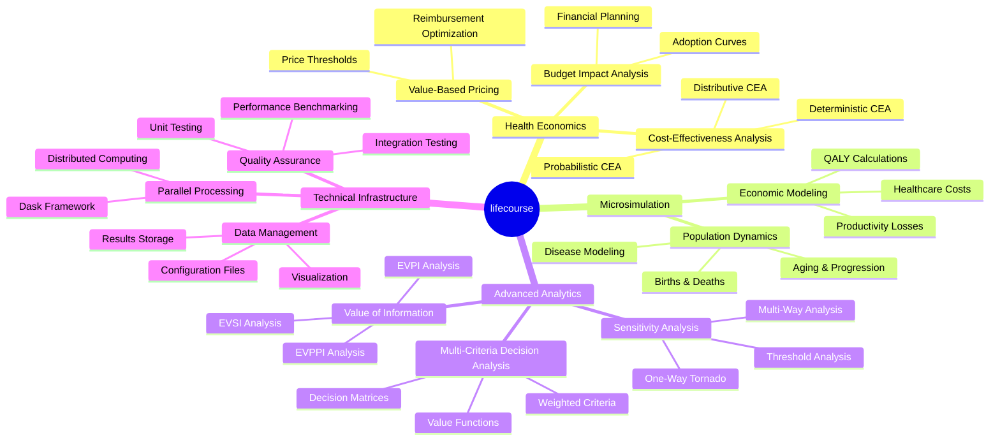
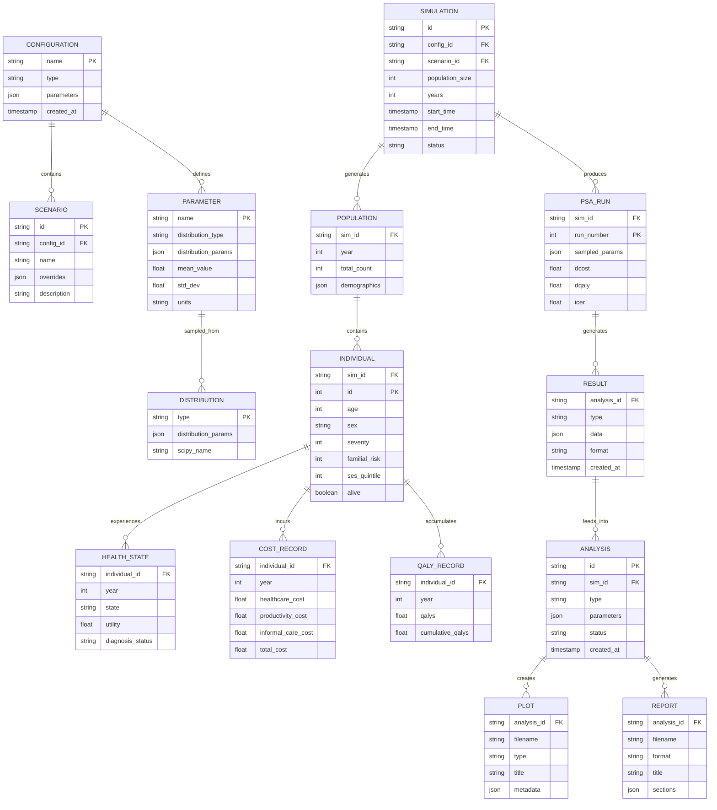
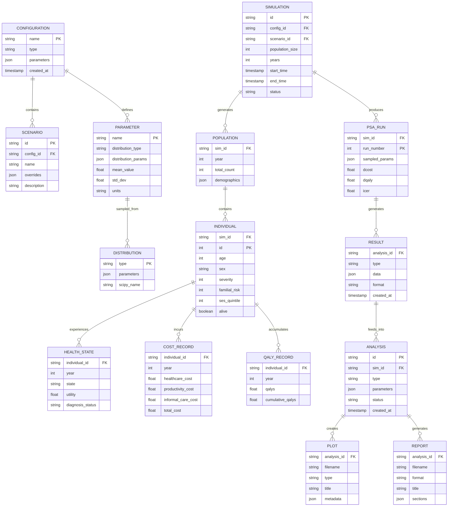

# LifeCourse Microsimulation Model - Design Specification

## 1. Introduction

### 1.1 Purpose

This design specification provides the technical architecture and implementation details for the LifeCourse microsimulation model. It complements the requirements specification by detailing how the system will be constructed to meet all functional and non-functional requirements.

### 1.2 Scope

The design covers:

- System architecture and component decomposition
- Data flow and interface specifications
- Implementation approaches for core simulation and advanced analysis modules
- Configuration and parameter management systems
- Visualization and reporting frameworks
- Performance optimization strategies
- Testing and validation approaches

### 1.3 Design Principles

- **Modularity**: Clean separation of concerns with well-defined interfaces
- **Scalability**: Dask-based parallel processing for computational efficiency
- **Extensibility**: Plugin architecture for adding new analysis modules
- **Reproducibility**: Deterministic execution with configurable random seeds
- **Maintainability**: Object-oriented design with comprehensive documentation

## 2. System Architecture

### 2.1 High-Level Architecture

```text
┌─────────────────────────────────────────────────────────────────┐
│                    lifecourse System                          │
├─────────────────────────────────────────────────────────────────┤
│  ┌─────────────┐  ┌─────────────┐  ┌─────────────┐  ┌─────────┐ │
│  │  CLI/API   │  │  Config     │  │   Analysis  │  │   Data  │ │
│  │ Interface  │◄►│ Management  │◄►│  Modules   │◄►│ Storage │ │
│  └─────────────┘  └─────────────┘  └─────────────┘  └─────────┘ │
├─────────────────────────────────────────────────────────────────┤
│  ┌─────────────────────────────────────────────────────────┐   │
│  │              Core Simulation Engine                     │   │
│  ├─────────────────────────────────────────────────────────┤   │
│  │  ┌─────────────┐  ┌─────────────┐  ┌─────────────┐      │   │
│  │  │ Population  │  │ Parameters  │  │ Population  │      │   │
│  │  │ Generation  │◄►│ & Sampling  │◄►│  System     │      │   │
│  │  └─────────────┘  └─────────────┘  └─────────────┘      │   │
│  └─────────────────────────────────────────────────────────┘   │
├─────────────────────────────────────────────────────────────────┤
│  ┌─────────────────────────────────────────────────────────┐   │
│  │            Advanced Analysis Framework                  │   │
│  ├─────────────────────────────────────────────────────────┤   │
│  │  ┌─────┐ ┌─────┐ ┌─────┐ ┌─────┐ ┌─────┐ ┌─────┐        │   │
│  │  │PSA  │ │VOI  │ │Dist.│ │BIA  │ │VBP  │ │MCDA │        │   │
│  │  │     │ │     │ │CEA  │ │     │ │     │ │     │        │   │
│  │  └─────┘ └─────┘ └─────┘ └─────┘ └─────┘ └─────┘        │   │
│  └─────────────────────────────────────────────────────────┘   │
├─────────────────────────────────────────────────────────────────┤
│  ┌─────────────────────────────────────────────────────────┐   │
│  │            Visualization & Reporting                    │   │
└─────────────────────────────────────────────────────────────────┘
```

#### Mermaid Version



### 2.2 Component Overview

#### 2.2.1 Core Components

- **CLI/API Interface**: Command-line and programmatic interfaces for system interaction
- **Configuration Management**: YAML-based parameter and scenario configuration
- **Core Simulation Engine**: Population generation, life course simulation, and economic evaluation
- **Analysis Modules**: Deterministic analysis, PSA, sensitivity analysis, and advanced methods
- **Data Storage**: Input/output handling for configurations, results, and visualizations

#### 2.2.2 Advanced Analysis Components

- **PSA Module**: Monte Carlo simulation and uncertainty quantification
- **VOI Module**: Expected value of information analysis (EVPI, EVPPI, EVSI)
- **Distributive CEA**: Equity analysis and distributional cost-effectiveness
- **BIA Module**: Budget impact analysis with adoption curves
- **VBP Module**: Value-based pricing optimization
- **MCDA Module**: Multi-criteria decision analysis frameworks

### 2.3 Data Flow Architecture

```text
Input Data → Configuration → Parameter Sampling → Simulation → Analysis → Output
     │             │               │              │           │         │
     ▼             ▼               ▼              ▼           ▼         ▼
  YAML Files → Parameter Sets → Dask Arrays → Population → Results → CSV/PNG
  Excel       → Scenario        → DataFrames   → States     → DataFrames Files
  JSON        → Overrides       → Series       → Trajectories          Excel
```

#### Mermaid Data Flow Version



### 2.4 Conceptual Architecture



### 2.5 Entity-Relationship Diagram


```

### 2.5 Entity-Relationship Diagram



### 2.6 Feature Matrix

| Feature Category | Feature | Status | Priority | Complexity | Dependencies |
|------------------|---------|--------|----------|------------|--------------|
| **Core Simulation** | Population Generation | ✅ Implemented | High | Medium | NumPy, Pandas |
| | Life Course Modeling | ✅ Implemented | High | High | Dask, SciPy |
| | Economic Evaluation | ✅ Implemented | High | Medium | NumPy |
| | Parameter Sampling | ✅ Implemented | High | Medium | SciPy |
| **Analysis Methods** | Deterministic CEA | ✅ Implemented | High | Low | Core Simulation |
| | Probabilistic Sensitivity Analysis | ✅ Implemented | High | Medium | Core Simulation |
| | One-Way Sensitivity | ✅ Implemented | Medium | Low | PSA |
| | Multi-Way Sensitivity | ✅ Implemented | Medium | Medium | PSA |
| | Tornado Diagrams | ✅ Implemented | Medium | Low | Sensitivity Analysis |
| **Value of Information** | Expected Value of Perfect Information (EVPI) | ✅ Implemented | High | High | PSA |
| | Expected Value of Partial Perfect Information (EVPPI) | ✅ Implemented | High | High | PSA, Regression |
| | Expected Value of Sample Information (EVSI) | ✅ Implemented | High | High | PSA, Bayesian Methods |
| **Distributive CEA** | Equity Analysis by SES | ✅ Implemented | High | Medium | PSA |
| | Concentration Indices | ✅ Implemented | High | Medium | PSA |
| | Subgroup ICERs | ✅ Implemented | High | Low | PSA |
| | Distributional Impacts | ✅ Implemented | High | Medium | PSA |
| **Budget Impact Analysis** | Adoption Curve Modeling | ✅ Implemented | High | Medium | Time Series |
| | Incremental Budget Costs | ✅ Implemented | High | Low | Core Simulation |
| | Uncertainty Quantification | ✅ Implemented | High | Medium | PSA |
| | Scenario Projections | ✅ Implemented | High | Medium | Adoption Curves |
| **Value-Based Pricing** | Price Threshold Analysis | ✅ Implemented | High | Medium | CEA |
| | Optimal Price Ranges | ✅ Implemented | High | Medium | CEA, WTP |
| | Reimbursement Scenarios | ✅ Implemented | High | Medium | CEA |
| | Market Dynamics | ✅ Implemented | High | Low | Price Thresholds |
| **Multi-Criteria Decision Analysis** | Weighted Criteria Evaluation | ✅ Implemented | High | Medium | Decision Theory |
| | Value Function Modeling | ✅ Implemented | High | High | Utility Theory |
| | Decision Matrices | ✅ Implemented | High | Low | MCDA Framework |
| | Sensitivity Analysis | ✅ Implemented | High | Medium | MCDA |
| **Visualization** | Cost-Effectiveness Plane | ✅ Implemented | High | Low | Matplotlib |
| | CEAC Curves | ✅ Implemented | High | Low | Matplotlib |
| | EVPI Curves | ✅ Implemented | High | Low | Matplotlib |
| | ENMB Curves | ✅ Implemented | High | Low | Matplotlib |
| | Tornado Plots | ✅ Implemented | Medium | Low | Matplotlib |
| | PSA Histograms | ✅ Implemented | Medium | Low | Matplotlib |
| | Budget Impact Curves | ✅ Implemented | High | Low | Matplotlib |
| | Price Threshold Curves | ✅ Implemented | High | Low | Matplotlib |
| | MCDA Radar Plots | ✅ Implemented | High | Low | Matplotlib |
| **Configuration** | YAML Configuration | ✅ Implemented | High | Low | PyYAML |
| | Scenario Overrides | ✅ Implemented | High | Low | Configuration |
| | Parameter Validation | ✅ Implemented | High | Medium | Schema Validation |
| **Performance** | Dask Parallel Processing | ✅ Implemented | High | High | Dask |
| | Memory Optimization | ✅ Implemented | High | Medium | Dask |
| | Scalable Population Sizes | ✅ Implemented | High | High | Dask |
| **Quality Assurance** | Unit Testing | ✅ Implemented | High | Medium | pytest |
| | Integration Testing | ✅ Implemented | High | Medium | pytest |
| | Performance Testing | ✅ Implemented | Medium | Medium | pytest-benchmark |
| | Code Coverage | ✅ Implemented | High | Low | pytest-cov |

**Legend:**

- ✅ **Implemented**: Feature is fully implemented and tested
- 🔄 **In Development**: Feature is partially implemented
- 📋 **Planned**: Feature is designed but not yet implemented
- **Priority**: High/Medium/Low based on requirements
- **Complexity**: Low/Medium/High based on implementation effort

### 3.1 Core Simulation Engine

#### Population Generation (`cohort.py`)

##### Class: PopulationGenerator

```python
class PopulationGenerator:
    def __init__(self, params: Dict[str, Any], arm: str = "prospective"):
        self.params = params
        self.arm = arm

    def generate_population(self, size: int) -> dd.DataFrame:
        """Generate synthetic population with baseline characteristics"""
        # Implementation using demographic distributions
        pass

    def assign_familial_status(self, population: dd.DataFrame) -> dd.DataFrame:
        """Assign familial disease risk based on prevalence"""
        pass
```

**Key Design Decisions:**

- Uses Dask DataFrames for lazy evaluation and parallel processing
- Supports both prospective and retrospective intervention arms
- Incorporates socioeconomic status, age, sex, and familial risk factors

#### Parameter Management (`parameters.py`)

##### Class: ParameterManager

```python
class ParameterManager:
    def __init__(self, distributions: Dict[str, Dict]):
        self.distributions = distributions

    def sample_parameters(self, seed: Optional[int] = None) -> Dict[str, float]:
        """Sample parameters from statistical distributions"""
        pass

    def get_mean_parameters(self) -> Dict[str, float]:
        """Get mean values for deterministic analysis"""
        pass

    def validate_parameters(self, params: Dict[str, Any]) -> bool:
        """Validate parameter ranges and types"""
        pass
```

**Key Design Decisions:**

- Supports Beta, Gamma, Lognormal, Normal, and Uniform distributions
- Provides both sampling and mean extraction methods
- Includes parameter validation and bounds checking

#### Population System (`population_system.py`)

##### Class: PopulationSystemDask

```python
class PopulationSystemDask:
    def __init__(self, pop_size: int, params: Dict[str, Any], arm: str):
        self.pop = gen_population_dask(pop_size, params, arm)
        self.params = prepare_dask_params(params)
        self.arm = arm

    def step(self, year: int) -> None:
        """Execute one year of simulation"""
        self._mortality()
        self._fertility()
        self._diagnosis()
        self._calculate_costs_and_qalys(year)

    def _mortality(self) -> None:
        """Apply mortality based on age, severity, and hazard ratios"""
        pass

    def _fertility(self) -> None:
        """Handle births and familial status inheritance"""
        pass

    def _diagnosis(self) -> None:
        """Model disease diagnosis and intervention effects"""
        pass

    def _calculate_costs_and_qalys(self, year: int) -> None:
        """Calculate annual costs and QALYs"""
        pass
```

**Key Design Decisions:**

- Dask-based parallel processing for population operations
- Memory-efficient partitioning for large populations
- Separate prospective/retrospective arm handling

### 3.2 Analysis Framework

#### 3.2.1 Run Helpers (`run_helpers.py`)

**Core Functions:**

```python
def run_sim(
    sampled_params: Dict[str, float],
    pop_size: int,
    seed_idx: Optional[int] = None,
    years: Optional[List[int]] = None,
    debug: bool = False
) -> Tuple[float, float]:
    """Execute simulation and return incremental cost and QALY results"""
    pass

def run_scenario(
    scenario_params: Dict[str, Any],
    pop_size: int,
    years: List[int],
    debug: bool = False
) -> Dict[str, Any]:
    """Execute scenario analysis with parameter overrides"""
    pass
```

**Key Design Decisions:**

- Unified interface for single runs and batch processing
- Automatic Dask scheduler selection based on debug mode
- Memory profiling and performance monitoring

#### 3.2.2 Advanced Analysis (`advanced_analysis.py`)

**Analysis Module Base Class:**

```python
class AnalysisModule(ABC):
    def __init__(self, base_params: Dict[str, Any], pop_size: int, years: List[int]):
        self.base_params = base_params
        self.pop_size = pop_size
        self.years = years

    @abstractmethod
    def execute(self, **kwargs) -> Dict[str, Any]:
        """Execute the analysis and return results"""
        pass

    def validate_inputs(self) -> bool:
        """Validate analysis inputs"""
        pass
```

**Key Design Decisions:**

- Abstract base class for consistent analysis interfaces
- Standardized result formats across all modules
- Input validation and error handling

## 4. Advanced Analysis Module Designs

### 4.1 Value of Information Analysis (VOI)

#### 4.1.1 EVPI Implementation

```python
class EVPIModule(AnalysisModule):
    def execute(self, psa_results: pd.DataFrame, wtp_range: np.ndarray) -> Dict[str, Any]:
        """Calculate Expected Value of Perfect Information"""
        # Implementation of EVPI calculation
        # ENMB = (QALYs * WTP) - Costs
        # EVPI = E[max(ENMB)] - max(E[ENMB])
        pass
```

**Algorithm:**

1. Calculate expected net monetary benefit (ENMB) for each PSA iteration
2. Compute expected value of current information: max(E[ENMB])
3. Compute expected value with perfect information: E[max(ENMB)]
4. EVPI = difference between steps 3 and 2

#### 4.1.2 EVPPI Implementation

```python
class EVPPIModule(AnalysisModule):
    def execute(
        self,
        psa_results: pd.DataFrame,
        parameter_sets: List[List[str]],
        wtp_range: np.ndarray
    ) -> Dict[str, Any]:
        """Calculate Expected Value of Partial Perfect Information"""
        # For each parameter subset:
        # 1. Regress ENMB on parameter subset
        # 2. Calculate EVPPI using regression metamodel
        pass
```

**Algorithm:**

1. For each parameter subset, fit regression metamodel: ENMB ~ parameters
2. Calculate EVPPI using metamodel predictions
3. Generate EVPPI curves across WTP values

#### 4.1.3 EVSI Implementation

```python
class EVSIModule(AnalysisModule):
    def execute(
        self,
        psa_results: pd.DataFrame,
        proposed_studies: List[Dict],
        wtp_range: np.ndarray
    ) -> Dict[str, Any]:
        """Calculate Expected Value of Sample Information"""
        # Implementation for different study designs
        # Uses Bayesian methods to estimate information value
        pass
```

### 4.2 Distributive Cost-Effectiveness Analysis

#### 4.2.1 Equity Analysis Module

```python
class DistributiveCEAModule(AnalysisModule):
    def execute(self, psa_results: pd.DataFrame, equity_dimensions: List[str]) -> Dict[str, Any]:
        """Perform equity analysis across socioeconomic and demographic groups"""
        # Calculate concentration indices
        # Analyze distributional impacts
        # Generate equity plots
        pass

    def calculate_concentration_index(self, outcomes: np.ndarray, rank: np.ndarray) -> float:
        """Calculate concentration index for inequality measurement"""
        pass
```

**Key Features:**

- Socioeconomic quintile analysis
- Concentration curves and indices
- Subgroup-specific ICERs
- Equity-efficiency trade-off analysis

### 4.3 Budget Impact Analysis

#### 4.3.1 BIA Module Design

```python
class BudgetImpactModule(AnalysisModule):
    def __init__(self, base_params: Dict[str, Any], pop_size: int, years: List[int]):
        super().__init__(base_params, pop_size, years)
        self.adoption_model = AdoptionCurveModel()

    def execute(
        self,
        intervention_costs: Dict[str, float],
        adoption_curve: Dict[str, Any],
        time_horizon: int = 5
    ) -> Dict[str, Any]:
        """Calculate budget impact over specified time horizon"""
        # Model adoption curves
        # Calculate incremental costs by year
        # Generate budget impact projections
        pass
```

**Components:**

- Adoption curve modeling (logistic, exponential, stepwise)
- Market penetration analysis
- Uncertainty quantification
- Scenario-based projections

### 4.4 Value-Based Pricing Analysis

#### 4.4.1 VBP Module Design

```python
class ValueBasedPricingModule(AnalysisModule):
    def execute(
        self,
        cost_effectiveness_results: pd.DataFrame,
        reimbursement_scenarios: List[Dict],
        market_constraints: Dict[str, Any]
    ) -> Dict[str, Any]:
        """Determine optimal value-based prices"""
        # Calculate price thresholds
        # Analyze pricing strategies
        # Model market dynamics
        pass

    def calculate_price_threshold(self, icer: float, wtp: float, utilization: float) -> float:
        """Calculate maximum cost-effective price"""
        pass
```

**Key Features:**

- Price threshold calculation
- Willingness-to-pay analysis
- Reimbursement scenario modeling
- Market access optimization

### 4.5 Price Threshold Analysis

#### 4.5.1 Threshold Analysis Module

```python
class PriceThresholdModule(AnalysisModule):
    def execute(
        self,
        psa_results: pd.DataFrame,
        wtp_range: np.ndarray,
        price_range: np.ndarray
    ) -> Dict[str, Any]:
        """Perform price threshold analysis"""
        # Generate threshold curves
        # Calculate acceptability frontiers
        # Analyze parameter sensitivity
        pass
```

**Algorithm:**

1. For each WTP value, find maximum acceptable price
2. Generate threshold curves across WTP ranges
3. Calculate acceptability frontiers

### 4.6 Multi-Criteria Decision Analysis

#### 4.6.1 MCDA Module Design

```python
class MCDAModule(AnalysisModule):
    def __init__(self, base_params: Dict[str, Any], pop_size: int, years: List[int]):
        super().__init__(base_params, pop_size, years)
        self.decision_criteria = self._load_criteria()

    def execute(
        self,
        alternatives: List[Dict],
        criteria_weights: Dict[str, float],
        value_functions: Dict[str, callable]
    ) -> Dict[str, Any]:
        """Perform MCDA evaluation"""
        # Normalize criteria scores
        # Apply value functions
        # Calculate weighted utilities
        # Generate decision matrices
        pass

    def _load_criteria(self) -> List[Dict]:
        """Load MCDA criteria definitions"""
        return [
            {"name": "cost_effectiveness", "direction": "minimize", "weight": 0.3},
            {"name": "equity", "direction": "maximize", "weight": 0.25},
            {"name": "budget_impact", "direction": "minimize", "weight": 0.2},
            {"name": "feasibility", "direction": "maximize", "weight": 0.15},
            {"name": "innovation", "direction": "maximize", "weight": 0.1}
        ]
```

**Key Features:**

- Weighted criteria evaluation
- Value function modeling
- Sensitivity analysis on weights
- Decision matrix generation

## 5. Data Management and Interfaces

### 5.1 Data Structures

#### 5.1.1 Population Data Model

```python
# Dask DataFrame schema for population
POPULATION_SCHEMA = {
    'id': 'int64',
    'age': 'int32',
    'sex': 'int8',  # 0=female, 1=male
    'severity': 'int8',  # 0=mild, 1=severe
    'familial': 'bool',
    'ses_quintile': 'int8',  # 1-5 socioeconomic quintile
    'annual_cost': 'float64',
    'annual_qaly': 'float64',
    'cumulative_cost': 'float64',
    'cumulative_qaly': 'float64',
    'alive': 'bool'
}
```

#### 5.1.2 Results Data Model

```python
# PSA Results DataFrame
PSA_RESULTS_SCHEMA = {
    'run': 'int32',
    'dCost': 'float64',
    'dQALY': 'float64',
    'ICER': 'float64',
    # Parameter columns...
    'familial_prop': 'float64',
    'yield_wgs': 'float64',
    # ... additional parameters
}
```

### 5.2 File Formats and Persistence

#### 5.2.1 Configuration Files

- **YAML**: Human-readable configuration with comments
- **JSON**: Programmatic configuration for API integration
- **Excel**: Template-based configuration for non-technical users

#### 5.2.2 Output Formats

- **CSV**: Tabular results for analysis and import
- **Excel**: Multi-sheet workbooks with formatting
- **Parquet**: Compressed binary format for large datasets
- **PNG/PDF**: Publication-quality visualizations

### 5.3 Interface Design

#### 5.3.1 CLI Interface

```bash
# Main execution
lifecourse-main --config_name DEFAULT_CONFIG --debug

# Scenario analysis
lifecourse-cli base --pop-size 1000 --debug

# Custom configuration
lifecourse-main --config_file custom.yaml
```

#### 5.3.2 Programmatic API

```python
from lifecourse import LifeCourseModel

# Initialize model
model = LifeCourseModel(config_file='config.yaml')

# Run analysis
results = model.run_analysis(
    analysis_type='psa',
    n_iterations=1000,
    scenarios=['base', 'intervention']
)

# Access results
print(results.summary())
results.plot_ce_plane()
```

## 6. Configuration and Parameter Management

### 6.1 Configuration Architecture

#### 6.1.1 Configuration Loader (`config/config_loader.py`)

```python
class ConfigLoader:
    def __init__(self):
        self.validators = self._load_validators()

    def load_config(
        self,
        config_name: Optional[str] = None,
        config_file_path: Optional[str] = None
    ) -> Dict[str, Any]:
        """Load and validate configuration"""
        pass

    def _load_validators(self) -> Dict[str, callable]:
        """Load parameter validation rules"""
        pass
```

#### 6.1.2 Scenario Management (`data_loader.py`)

```python
class ScenarioManager:
    def __init__(self, scenarios_file: str = 'config/scenarios.yaml'):
        self.scenarios = self._load_scenarios()

    def apply_scenario_overrides(
        self,
        base_params: Dict[str, float],
        overrides: Dict[str, Any]
    ) -> Dict[str, float]:
        """Apply relative or absolute parameter modifications"""
        pass

    def generate_scenario_grid(self, parameter_ranges: Dict[str, List[float]]) -> List[Dict]:
        """Generate parameter combinations for sensitivity analysis"""
        pass
```

### 6.2 Parameter Validation

#### 6.2.1 Validation Rules

```python
PARAMETER_VALIDATION_RULES = {
    'pop_size': {'type': 'int', 'min': 100, 'max': 100000},
    'psa_n': {'type': 'int', 'min': 100, 'max': 10000},
    'familial_prop': {'type': 'float', 'min': 0.0, 'max': 1.0},
    'yield_wgs': {'type': 'float', 'min': 0.0, 'max': 1.0},
    # ... additional parameters
}
```

## 7. Visualization and Reporting Framework

### 7.1 Plotting Architecture (`plotting.py`)

#### 7.1.1 Base Plotting Classes

```python
class EconomicPlot(ABC):
    def __init__(self, figsize: Tuple[int, int] = (10, 8)):
        self.figsize = figsize
        self.style = self._set_publication_style()

    @abstractmethod
    def plot(self, data: Any, **kwargs) -> plt.Figure:
        """Generate the plot"""
        pass

    def _set_publication_style(self):
        """Set matplotlib style for publication-quality plots"""
        pass

class CEPlanePlot(EconomicPlot):
    def plot(self, dcost: np.ndarray, dqaly: np.ndarray, wtp: np.ndarray) -> plt.Figure:
        """Generate cost-effectiveness plane"""
        pass

class CEACPlot(EconomicPlot):
    def plot(self, wtp: np.ndarray, nb_matrix: np.ndarray) -> plt.Figure:
        """Generate cost-effectiveness acceptability curve"""
        pass
```

#### 7.1.2 Advanced Visualization Classes

```python
class VOIPlot(EconomicPlot):
    def plot_evpi(self, evpi_values: np.ndarray, wtp: np.ndarray) -> plt.Figure:
        pass

    def plot_evppi(self, evppi_curves: Dict[str, np.ndarray], wtp: np.ndarray) -> plt.Figure:
        pass

class BudgetImpactPlot(EconomicPlot):
    def plot_budget_curve(self, budget_projection: pd.DataFrame) -> plt.Figure:
        pass

class MCDAVisualization(EconomicPlot):
    def plot_radar(self, criteria_scores: pd.DataFrame) -> plt.Figure:
        pass

    def plot_value_functions(self, value_functions: Dict[str, callable]) -> plt.Figure:
        pass
```

### 7.2 Reporting Framework

#### 7.2.1 Report Generator

```python
class ReportGenerator:
    def __init__(self, results_dir: str = 'results'):
        self.results_dir = results_dir
        self.template_engine = self._load_templates()

    def generate_full_report(
        self,
        analysis_results: Dict[str, Any],
        include_plots: bool = True,
        format: str = 'html'
    ) -> str:
        """Generate comprehensive analysis report"""
        pass

    def generate_executive_summary(self, key_findings: Dict[str, Any]) -> str:
        """Generate executive summary"""
        pass
```

## 8. Performance and Scalability Design

### 8.1 Dask Integration Strategy

#### 8.1.1 Cluster Configuration

```python
class DaskManager:
    def __init__(self):
        self.cluster = None
        self.client = None

    def initialize_cluster(self, debug: bool = False) -> Client:
        """Initialize optimized Dask cluster"""
        if debug:
            # Single-threaded for debugging
            self.cluster = LocalCluster(
                n_workers=1,
                threads_per_worker=1,
                memory_limit='2GB',
                silence_logs=False
            )
        else:
            # Production configuration
            cpu_count, memory_gb = self._get_system_resources()
            self.cluster = LocalCluster(
                n_workers=min(cpu_count, 8),
                threads_per_worker=max(1, cpu_count // 8),
                memory_limit=f"{max(1, memory_gb // 8)}GB",
                silence_logs=True
            )

        self.client = Client(self.cluster)
        return self.client

    def _get_system_resources(self) -> Tuple[int, float]:
        """Probe system resources for optimal configuration"""
        pass
```

#### 8.1.2 Memory Management

- **Partitioning Strategy**: Adaptive partitioning based on population size
- **Lazy Evaluation**: Dask delayed computation for memory efficiency
- **Garbage Collection**: Explicit cleanup of intermediate results
- **Memory Profiling**: Built-in monitoring for optimization

### 8.2 Parallel Processing Patterns

#### 8.2.1 PSA Execution Pattern

```python
def run_parallel_psa(psa_args: List[Tuple], client: Client) -> List[Tuple[float, float]]:
    """Execute PSA iterations in parallel"""
    futures = client.map(run_sim, psa_args)
    return client.gather(futures)
```

#### 8.2.2 Batch Processing

- **Chunking**: Divide large populations into manageable partitions
- **Load Balancing**: Distribute work across available cores
- **Fault Tolerance**: Handle worker failures gracefully
- **Progress Monitoring**: Real-time progress tracking for long runs

## 9. Testing and Validation Strategy

### 9.1 Unit Testing Framework

#### 9.1.1 Test Organization

```text
tests/
├── __init__.py
├── test_parameters.py          # Parameter sampling and validation
├── test_cohort.py             # Population generation
├── test_population_system.py  # Core simulation logic
├── test_run_helpers.py        # Analysis orchestration
├── test_advanced_analysis.py  # VOI, MCDA, etc.
├── test_plotting.py           # Visualization functions
├── test_config_loader.py      # Configuration management
├── test_data_loader.py        # Scenario handling
└── test_integration.py        # End-to-end workflows
```

#### 9.1.2 Test Fixtures

```python
@pytest.fixture
def base_parameters():
    """Provide standard parameter set for testing"""
    return get_mean_params(DISTRIBUTIONS)

@pytest.fixture
def small_population():
    """Generate small test population"""
    return gen_population_dask(100, base_parameters(), "prospective")

@pytest.fixture
def mock_psa_results():
    """Generate mock PSA results for analysis testing"""
    np.random.seed(42)
    return pd.DataFrame({
        'dCost': np.random.normal(10000, 2000, 100),
        'dQALY': np.random.normal(0.5, 0.1, 100)
    })
```

### 9.2 Integration Testing

#### 9.2.1 End-to-End Test Scenarios

```python
def test_full_analysis_workflow():
    """Test complete analysis pipeline"""
    # Setup
    config = load_config('MINIMAL_TEST_CONFIG')

    # Execute
    results = run_full_analysis(config)

    # Validate
    assert 'deterministic_results' in results
    assert 'psa_results' in results
    assert 'plots' in results
    assert len(results['psa_results']) == config['PSA_N']

def test_scenario_analysis():
    """Test scenario comparison functionality"""
    scenarios = load_scenarios_from_yaml('config/scenarios.yaml')
    results = {}

    for name, overrides in scenarios.items():
        params = apply_scenario_overrides(get_mean_params(DISTRIBUTIONS), overrides)
        results[name] = run_sim(params, pop_size=1000, years=range(2024, 2034))

    # Validate scenario differences
    assert results['high_yield']['dQALY'] > results['low_yield']['dQALY']
```

### 9.3 Performance Testing

#### 9.3.1 Benchmarking Framework

```python
def benchmark_psa_performance(pop_sizes: List[int], psa_iterations: List[int]):
    """Benchmark PSA performance across configurations"""
    results = []

    for pop_size in pop_sizes:
        for n_psa in psa_iterations:
            start_time = time.time()

            # Run PSA
            psa_results = run_psa_analysis(pop_size=pop_size, n_iterations=n_psa)

            execution_time = time.time() - start_time

            results.append({
                'pop_size': pop_size,
                'psa_iterations': n_psa,
                'execution_time': execution_time,
                'memory_peak': get_memory_usage()
            })

    return pd.DataFrame(results)
```

## 10. Deployment and Distribution

### 10.1 Packaging Strategy

#### 10.1.1 Python Package Structure

```text
lifecourse/
├── __init__.py
├── main.py                    # CLI entry point
├── cli.py                     # Additional CLI commands
├── model/
│   ├── __init__.py
│   ├── parameters.py
│   ├── cohort.py
│   └── population_system.py
├── analysis/
│   ├── __init__.py
│   ├── run_helpers.py
│   ├── advanced_analysis.py
│   └── plotting.py
├── config/
│   ├── __init__.py
│   ├── config_loader.py
│   └── simulation_configs.py
├── data_loader.py
├── lifecourse.egg-info/
└── tests/
```

#### 10.1.2 Entry Points (pyproject.toml)

```toml
[project.scripts]
lifecourse-cli = "lifecourse.cli:main"
lifecourse-main = "lifecourse.main:main"
```

### 10.2 Installation and Dependencies

#### 10.2.1 Core Dependencies

```toml
dependencies = [
    "numpy>=1.21.0",
    "pandas>=1.3.0",
    "scipy>=1.7.0",
    "dask>=2022.1.0",
    "distributed>=2022.1.0",
    "matplotlib>=3.5.0",
    "seaborn>=0.11.0",
    "pyyaml>=6.0",
    "psutil>=5.8.0",
    "openpyxl>=3.0.0"
]
```

#### 10.2.2 Development Dependencies

```toml
[project.optional-dependencies]
dev = [
    "pytest>=7.0.0",
    "pytest-cov>=4.0.0",
    "black>=22.0.0",
    "isort>=5.10.0",
    "mypy>=0.950",
    "sphinx>=5.0.0"
]
```

### 10.3 Platform Compatibility

- **Python Version**: 3.10+ (uses modern type hints and pattern matching)
- **Operating Systems**: Windows, macOS, Linux
- **Architecture**: x86_64, ARM64
- **Memory Requirements**: Minimum 4GB RAM, recommended 8GB+
- **Storage Requirements**: 500MB for installation, variable for results

## 11. Security and Safety Considerations

### 11.1 Data Protection

- **Input Validation**: All configuration inputs validated against schemas
- **Parameter Bounds**: Strict bounds checking on all parameters
- **Error Handling**: Graceful failure with informative error messages
- **Memory Safety**: Bounds checking for array operations

### 11.2 Reproducibility

- **Random Seeds**: Configurable seeds for all stochastic operations
- **Version Control**: Explicit dependency versioning
- **Environment Capture**: System state logging for debugging

### 11.3 Performance Safety

- **Resource Limits**: Automatic resource detection and limits
- **Timeout Handling**: Configurable timeouts for long-running operations
- **Memory Monitoring**: Continuous monitoring with automatic cleanup

## 12. Future Extensibility

### 12.1 Plugin Architecture

```python
class AnalysisPlugin(ABC):
    """Base class for analysis plugins"""

    @property
    @abstractmethod
    def name(self) -> str:
        """Plugin name"""
        pass

    @abstractmethod
    def execute(self, context: AnalysisContext) -> AnalysisResult:
        """Execute the analysis"""
        pass

    @abstractmethod
    def get_required_parameters(self) -> List[str]:
        """List required parameters"""
        pass
```

### 12.2 Extension Points

- **Custom Disease Models**: Plugin interface for alternative disease progression
- **Additional Visualizations**: Plot plugin system
- **External Data Sources**: Data import/export plugins
- **Alternative Solvers**: Custom optimization algorithms

## 13. Developer Guidance

### 13.1 Project Overview

This repository implements a microsimulation model (lifecourse) for health economic evaluation. Core logic lives under `src/lifecourse/`.

**Major components:**

- `src/lifecourse/model/` — parameter definitions (`parameters.py`), cohort generation (`cohort.py`), and the simulation engine (`population_system.py`).
- `src/lifecourse/analysis/` — orchestration helpers (`run_helpers.py`), plotting and advanced analyses.
- `src/lifecourse/cli.py` and `src/lifecourse/main.py` — entrypoints used for CI, ad-hoc runs, and `python -m lifecourse.main`.

**Data flow:** configuration -> parameter sampling (DISTRIBUTIONS) -> prepare dask params -> PopulationSystemDask instances -> run per-year steps -> aggregate outputs (deterministic & PSA CSVs in `results/`). See `main.py` and `analysis/run_helpers.py` for examples.

### 13.2 Developer Workflows & Common Commands

- Install deps: `pip install -r requirements.txt` (project requires Python >=3.10, see `pyproject.toml`).
- Run full analysis locally (single-process debug):
  - `python -m lifecourse.main --config_name MINIMAL_TEST_CONFIG --debug`
- Run a single scenario via CLI (fast, small pop):
  - `python -m lifecourse.cli base --pop-size 100 --debug`
- Run tests: `pytest -q` (tests rely on `src` being importable; the test harness already adjusts sys.path in `run_tests.py`).
- Use `--debug` flags to force single-threaded execution and verbose memory prints — helpful for reproducing or diagnosing issues (see `main.py` and `analysis/run_helpers.py`).

### 13.3 Project-Specific Conventions and Patterns

- **Dask-first design**: computations frequently return Dask objects (DataFrame/Series/arrays). Only call `.compute()` or `dd.compute(...)` at aggregation points. See `run_helpers.run_sim` and `run_scenario` for how Dask objects are collected and computed.
- **Parameter overrides from YAML**: `config/scenarios.yaml` uses relative vs absolute overrides. Small magnitude numeric changes (within ~±0.5) are treated as relative deltas; large magnitudes are absolute replacements. `apply_scenario_overrides` is used in `cli.py` and `main.py`.
- **Random seeds**: `run_sim` seeds numpy and python random with a base (42) + run index. When adding reproducible tests or debug runs, follow this seed pattern.
- **Resource-aware Dask config**: `main.py` probes system CPUs and memory using `psutil` and configures `LocalCluster`. When changing parallelism, prefer tuning in `main.py` logic rather than hardcoding workers elsewhere.
- **Population arms**: the engine creates two PopulationSystemDask instances with `arm` values `retrospective` and `prospective`. Most analyses compute difference (prospective - retrospective).

### 13.4 Integration Points & External Dependencies

- External YAML scenarios: `config/scenarios.yaml` — used to drive deterministic runs and scenario grids. Example keys: `familial_prop`, `yield_wgs`, `min_test_age`.
- Entry points (packaged scripts): defined in `pyproject.toml` under `[project.scripts]` — `lifecourse-cli` and `lifecourse-main` map to `lifecourse.cli:main` and `lifecourse.main:main`.
- Key third-party libs to be mindful of: Dask (distributed), pandas, numpy, psutil (resource probing), scipy (distributions), matplotlib/seaborn (plotting).

### 13.5 Code Editing Guidelines

When editing code, prefer small, well-scoped changes:

- Preserve Dask laziness. If you add new aggregation code, mirror existing pattern: collect Dask objects into a list, call `dd.compute(*list)` once, and then process pandas results.

- If new CLI flags are added, register them in `cli.py` and `main.py` for symmetry and update any code paths that call `load_config` (see `config/config_loader.py`).

- Unit tests: follow existing style in `tests/` — there is a mixture of pytest-based tests and custom `run_tests.py` harness that adjusts sys.path; prefer pytest-compatible tests for CI.

### 13.6 Key Files for Context

- `README.md` — high-level overview and common commands.
- `pyproject.toml` — Python requirements, scripts, and metadata.
- `src/lifecourse/main.py` — full-analysis entrypoint, Dask config, PSA orchestration.
- `src/lifecourse/cli.py` — lightweight scenario CLI used in quick runs and CI.
- `src/lifecourse/analysis/run_helpers.py` — canonical patterns for seeding, Dask scheduling, memory checks, and how run_sim/run_scenario return values are shaped.
- `src/lifecourse/model/parameters.py` and `src/lifecourse/model/population_system.py` — parameter names and the main simulation primitives.
- `config/scenarios.yaml` — scenario examples and grid definitions.

### 13.7 Safety and Testing Guidance

- Never remove the Dask/compute separation. Merging compute calls into per-iteration computes will drastically increase memory and time.
- When adding parameters, update `parameters.py` DISTRIBUTIONS and `get_mean_params` helper so sampling and mean extraction remain consistent.
- Keep `--debug` behavior: it is used heavily in tests and by developers to reproduce issues locally.

---

*Design Document Version: 1.0*
*Last Updated: October 2025*
*Author: lifecourse Development Team*
*Corresponding Requirements: requirements.md v1.0*
